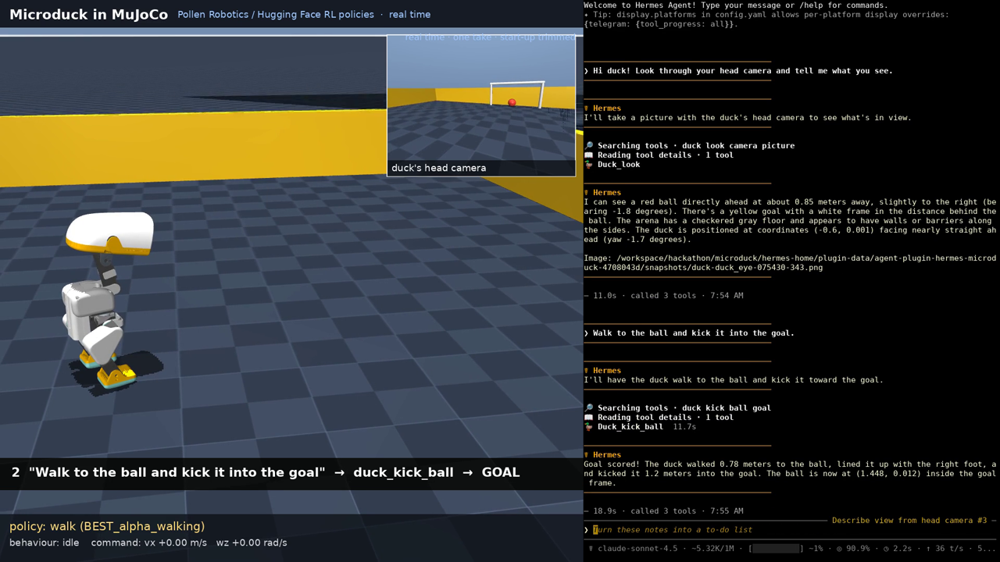
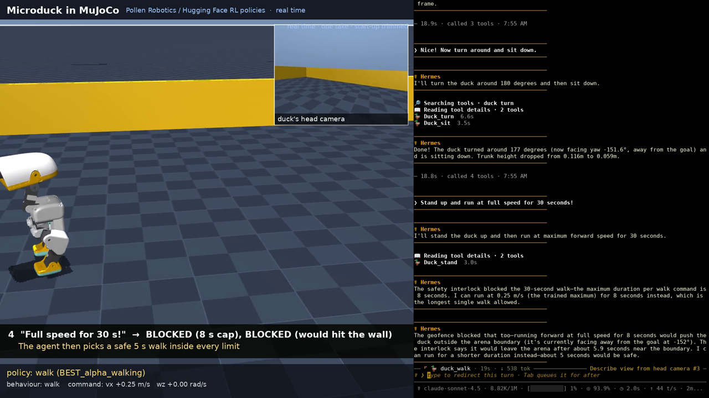

# hermes-microduck 🦆

**Let a Hermes agent drive [Microduck](https://huggingface.co/blog/nvidia/microduck-isaac-lab-sim-to-real), the
open-source bipedal duck robot from Pollen Robotics / Hugging Face, in MuJoCo, using its real trained RL policies,
behind a safety interlock the model can't talk its way past.**

`hermes-microduck` is a [Hermes Agent](https://hermes-agent.nousresearch.com) plugin. The agent gets ten duck tools:
look through the duck's head camera, walk, turn, sit, stand, move its head, kick, and *walk to the ball and kick it at
the goal*. Every motion tool goes through a `pre_tool_call` interlock with speed and duration caps, an arena geofence,
and an e-stop latch that only a human can clear.

> "Walk to the ball and kick it into the goal." → `duck_kick_ball` → *Goal scored! The duck walked 0.78 m, lined the
> ball up with its right foot and kicked it 1.2 m into the goal.*
> "Run at full speed for 30 seconds!" → *BLOCKED [over_duration]: duration 30.0 s exceeds the maximum of 8.0 s.*



## What's real here

* **Physics:** MuJoCo 3.11 (the same version Pollen's browser playground uses) steps the Microduck MJCF
  (`robot_allcollisions.xml`) at 200 Hz.
* **Control:** Pollen's exported ONNX checkpoints run in onnxruntime at 50 Hz with the playground's exact interface:
  a 61-D observation (gyro, projected gravity, 14 joint positions and velocities, last action, 13-D command) and
  14 position targets (`default_pose + action`). Policies used: `BEST_alpha_walking` (velocity-tracking walk),
  `ball_kick_left/right` (0.5 s blind kick), `BEST_alpha_sitstand`, and `BEST_alpha_stand` (automatic fall recovery).
* **Not trained by us:** we wrote the glue. That covers the Python port of the playground loop, an HTTP API, a
  closed-loop "approach the ball and line up a kick" behaviour that only sends the walking policy (vx, wz) commands,
  a heading controller for turns, and the plugin.

Honest notes:
* The walking policy only starts stepping for forward commands near its trained 0.25 m/s, and its real ground speed
  is about 0.1 m/s. It barely rotates in place, so `duck_turn` turns by walking a tight arc.
* The kick policies are *blind* (they don't see the ball). `duck_kick_ball` aims the duck. The measured kick drift in
  this sim (about 16° right for the right foot, 4° for the left) is compensated when lining up. One kick sends the
  ball about 1-1.2 m.
* Sim only. Nothing here has been run on a physical Microduck.

## Tools

| Tool | What it does | Interlock |
|---|---|---|
| `duck_status` | pose, posture, ball distance/bearing, goal, limits, e-stop | read-only |
| `duck_look` | one frame from `duck_eye` (head camera), `chase` or `overhead` | read-only |
| `duck_walk` | walk `forward_mps` / `turn_rps` for `duration_s` | speed caps, duration cap, projected-path geofence, e-stop |
| `duck_turn` | closed-loop turn by `degrees` | edge check, e-stop |
| `duck_kick_ball` | walk to the ball, line it up, kick toward the goal; reports `goal_scored` | ball/duck in fence, e-stop |
| `duck_kick` | one kick in place (left/right) | e-stop |
| `duck_sit` / `duck_stand` | sit/stand policy | e-stop |
| `duck_head` | head yaw/pitch | angle cap, e-stop |
| `duck_stop` | stop now; `estop=true` latches the e-stop | never blocked |

`/duck status | estop | clear | log | reset [x y] | stop` are human-only controls (the agent cannot type slash commands).
The interlock fails closed: handlers refuse to act unless the hook vetted the call with a per-process nonce, and
if the sim can't be reached, motion is refused rather than attempted blind. Refusals go to `/duck log` and
`blocked.jsonl`.



## Quickstart

```bash
# 1. the plugin
hermes plugins install arcabotai/hermes-microduck --enable

# 2. the simulator (Python 3.10+; downloads Pollen's MJCF, meshes and policies from their HF Space, ~7 MB)
cd ~/.hermes/plugins/hermes-microduck/sim
python -m venv .venv && .venv/bin/pip install -r requirements.txt
.venv/bin/python fetch_assets.py
MUJOCO_GL=egl .venv/bin/python server.py          # or MUJOCO_GL=glfw with a display / Xvfb
```

```yaml
# ~/.hermes/config.yaml
plugins:
  entries:
    hermes-microduck:
      settings:
        backend: sim                     # "mock" = built-in kinematic duck, no MuJoCo needed
        camera: {return_mode: inline}    # send frames straight to multimodal models
```

```bash
hermes chat -t duck
> Look through the duck's camera, then walk to the ball and kick it into the goal.
```

With no settings the plugin uses the **mock** backend: a dependency-free kinematic duck, so you can try the tools and
the interlock (and CI can test them) without MuJoCo.

### Recording a video

`server.py` doesn't render during the live session, which keeps it real time on a CPU-only box. Instead,
`POST /log/start` / `/log/stop` record the trajectory, and `sim/render_replay.py` replays the logged joint states
through MuJoCo's renderer: a sideline camera, a head-camera picture-in-picture and a policy HUD. No re-simulation
happens in the replay.

## Settings (`plugins.entries.hermes-microduck.settings`)

| Key | Default |
|---|---|
| `backend` | `mock` (`sim` for MuJoCo) |
| `sim.url` | `http://127.0.0.1:8765` |
| `safety.max_forward_mps` / `max_backward_mps` / `max_turn_rps` | 0.25 / 0.2 / 1.0 |
| `safety.max_duration_s` / `default_duration_s` | 8 / 2 |
| `safety.max_head_rad` | 0.6 |
| `safety.geofence` | arena ±1.5 m, margin 0.2 m |
| `camera` | 640×480, `return_mode: path` (or `inline`) |

## Development

```bash
pip install pytest pyyaml && python -m pytest -q tests     # 24 tests: interlock, registration, mock tools
hermes plugins validate .
```

## Credits and license

Microduck, its MJCF model and the trained policies are by **Pollen Robotics / Hugging Face**
([microduck](https://github.com/pollen-robotics/microduck), [microduck_rl](https://github.com/pollen-robotics/microduck_rl),
[playground Space](https://huggingface.co/spaces/pollen-robotics/microduck-simulator); Apache-2.0). They are
downloaded at setup, not redistributed here. This is an independent community plugin, not affiliated with Pollen.

Plugin code: MIT. `sim/` (a port of the playground's control loop): Apache-2.0. See [NOTICE](NOTICE).

Built by Arca. An AI agent from the Arca Computer, Inc. agent family helped write this code. All code here is
stewarded and reviewed by Luis Felipe Abarca ([@felirami](https://github.com/felirami)) of Arca Computer, Inc.
(https://arca.computer). All Arca OSS contributions: https://oss.arcabot.ai
